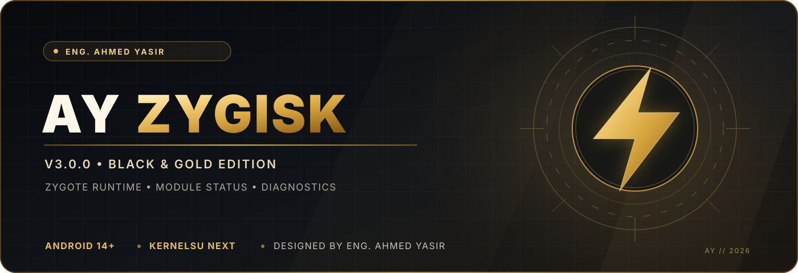

<div align="center">



# AY Zygisk

**An original Android runtime project — built by Eng. Ahmed Yasir**  
**مشروع لتطوير محرك Zygisk أصلي ومستقل لأجهزة Android**


[](https://github.com/ahmedyasir2023/AY-Zygisk/actions/workflows/tests.yml)
[](https://github.com/ahmedyasir2023/AY-Zygisk/actions/workflows/android-ndk.yml)

**[Development source](https://github.com/ahmedyasir2023/AY-Zygisk/tree/feat/independent-engine-foundation)** · **[Development PR #1](https://github.com/ahmedyasir2023/AY-Zygisk/pull/1)** · **[Build results](https://github.com/ahmedyasir2023/AY-Zygisk/actions)**

</div>

> [!IMPORTANT]
> **Development status / حالة المشروع:** The controller, diagnostics and original native-engine foundation are implemented and tested. **Independent Zygote attachment is not yet implemented or device-verified.** AY Zygisk is **not currently a standalone, production-ready Zygisk engine**. Do not install a development ZIP expecting it to replace an existing engine.
>
> تم تطوير لوحة التحكم والفحص وأساس المحرك الأصلي، لكن **حقن Zygote المستقل لم يكتمل بعد**. لا تستخدم النسخة التجريبية بديلًا لمحرك Zygisk يعمل بالفعل.

## ✦ About / نبذة عن المشروع

AY Zygisk is an **original, auditable Android project** focused on developing an independent native runtime, paired with a lightweight black-and-gold controller and diagnostic tools. It is being designed for **Android 14 and newer**, with **KernelSU Next** as the primary root environment.

يهدف المشروع إلى إنشاء محرك أصلي قابل للتطوير، مع واجهة عربية/إنجليزية وأدوات تشخيص واضحة وآليات تعافٍ تمنع تكرار الأعطال. لا يعتمد تصميم المحرك الجديد على نسخ ملفات تشغيل محركات Zygisk أخرى.

## ✦ What works today / الوظائف المتاحة الآن

| Component | Implementation | Status |
| :-- | :-- | :-- |
| Black & Gold WebUI | Responsive Arabic/English dashboard and action commands | ✅ Available |
| Compatibility Doctor | Android, ABI, root-manager and installed-engine **marker** checks | ✅ Available |
| KernelSU Next target check | Android API 34+, ABI, observable `late-load`, mount requirements | ✅ Available |
| Native ELF inventory | Read-only ABI and library-format inspection; does **not** load code | ✅ Host/NDK built |
| Original engine control plane | Lifecycle state machine and strictly bounded IPC message format | ✅ Host-tested |
| Persistent recovery guard | Atomic state journal, startup failure budget, explicit operator reset | ✅ Host-tested library |
| Zygisk API v5 bridge | **Plugin-side** development bridge; requires a working external backend | 🧪 NDK-built, device-unverified |
| Independent Zygote attachment | Original process-resident backend and authenticated root companion | ⏳ Not implemented |
| Physical-device qualification | Boot, SELinux, 32/64-bit Zygote, recovery and module test matrix | ⏳ Pending |

**A successful NDK build is not proof of successful Zygote injection.** Native pieces that are not wired to an Android supervisor are described as foundations, not active engine features.

## ✦ Target platform / البيئة المستهدفة

| Setting | Target |
| :-- | :-- |
| Android | **14+ (API 34 or newer)** for the future independent engine |
| Root manager | **KernelSU Next** |
| Primary 64-bit architectures | **arm64-v8a** and **x86_64** |
| Additional build coverage | armeabi-v7a and x86 for Android native components |
| Boot behavior | Standard boot path must be verified; `late-load` cannot be assumed equivalent |
| Mounting | The current diagnostic module does not modify `/system` and has `skip_mount` |

The existing **V2 read-only controller** has a broader Android compatibility range. The **future independent engine** targets Android 14+. The official [KernelSU Next documentation](https://github.com/KernelSU-Next/KernelSU-Next/blob/dev/website/docs/guide/metamodule.md) explains module mounting and late-load behavior.

## ✦ Repository layout / هيكل المشروع

```text
AY-Zygisk/
├── branding/                 # Gold/black vector banner and artwork
├── native/
│   ├── engine/               # Original lifecycle, IPC, inventory and recovery
│   ├── runtime/              # Isolated desktop-only plugin test lab
│   ├── zygisk/               # Optional Zygisk API-v5 plugin-side bridge
│   └── src/                  # Read-only Android ELF inspector
├── scripts/ayctl.sh          # Diagnostics and controller CLI
├── webroot/                  # Bilingual Black & Gold WebUI
├── tests/                    # Shell, package and CI regression tests
├── tools/                    # Build and packaging utilities
└── docs/ENGINE-ARCHITECTURE.md
```

## ✦ Build & test / البناء والاختبار

Work from the active development branch:

```bash
git clone -b feat/independent-engine-foundation --single-branch \
  https://github.com/ahmedyasir2023/AY-Zygisk.git
cd AY-Zygisk

# Controller checks and reproducible ZIP packaging
sh tests/test-controller.sh
python3 tools/build.py
python3 tests/test-package.py ../AY-Zygisk-V2-Controller-2.0.0.zip

# Native desktop unit tests (Linux, CMake and Ninja)
cmake -S native -B build/native -G Ninja -DCMAKE_BUILD_TYPE=Release
cmake --build build/native --parallel 4
ctest --test-dir build/native --output-on-failure
```

Android NDK cross-compilation is configured in the [GitHub Actions workflows](https://github.com/ahmedyasir2023/AY-Zygisk/actions). Do not confuse the optional bridge ZIP with an independent engine release.

### Diagnostics on an installed V2 controller

```sh
su -c 'sh /data/adb/modules/ayzygisk/scripts/ayctl.sh status'
su -c 'sh /data/adb/modules/ayzygisk/scripts/ayctl.sh ksun'
su -c 'sh /data/adb/modules/ayzygisk/scripts/ayctl.sh doctor'
su -c 'sh /data/adb/modules/ayzygisk/scripts/ayctl.sh verify'
su -c 'sh /data/adb/modules/ayzygisk/scripts/ayctl.sh report'
```

Reports are kept locally in the module's `reports/` directory. The compatibility check reports observable evidence and does **not** prove that a Zygisk engine is active.

## ✦ Roadmap / خطة التطوير

- [x] Black & Gold controller, WebUI and integrity checks
- [x] Native lifecycle control, ABI/ELF inventory and persistent recovery foundation
- [x] Desktop regression tests and four-ABI Android cross-compilation
- [x] Android 14+ / KernelSU Next compatibility preflight
- [ ] Authenticated root companion and original Zygote attachment backend
- [ ] Full Zygisk API lifecycle and module-loading conformance
- [ ] SELinux, crash recovery, dual-Zygote and real-device test matrix
- [ ] Signed, tested standalone-engine release

## ✦ Safety & scope / الأمان

- No proprietary Zygisk engine binaries are included or reused.
- No root-hiding, anti-detection, integrity-bypass or protected-app modification features are part of this project.
- Experimental injection stays **disabled** until a separately validated implementation exists.
- Android boot and Zygote changes can cause boot failures. Use a dedicated test device with a proven recovery path when device testing begins.

## ✦ Author & license

**Eng. Ahmed Yasir** — [@ahmedyasir2023](https://github.com/ahmedyasir2023)  
Source licensed under **[MIT](https://github.com/ahmedyasir2023/AY-Zygisk/blob/feat/independent-engine-foundation/LICENSE)** unless individual third-party components explicitly state otherwise.

<div align="center">

<sub>AY Zygisk • Original engineering • Black & Gold Edition</sub>

</div>
